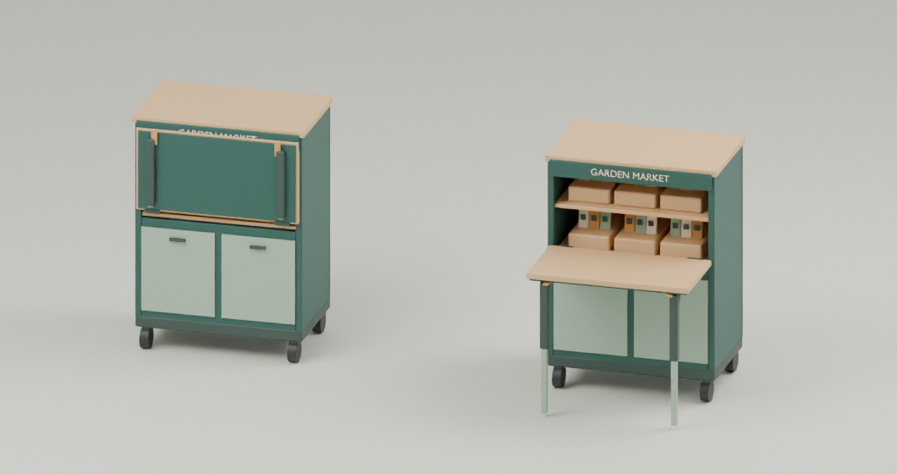
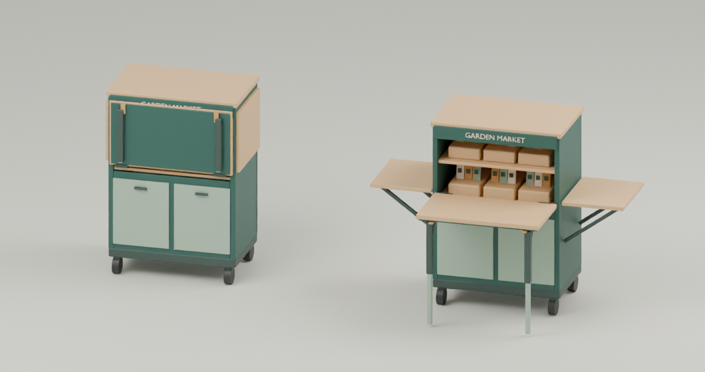
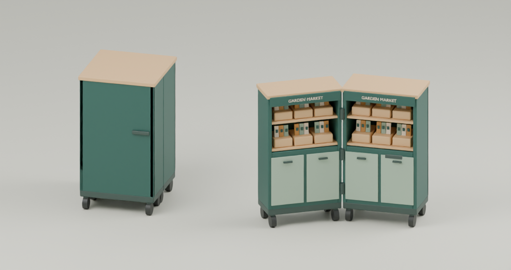

# Fold-out Garden Market

Each Blender scene shows the same stall stored on the left and ready for customers on the right. Open a .blend file to inspect the parts or use a PNG directly in the slides.

| Design | How it opens | Main tradeoff |
| --- | --- | --- |
| [Drop-front counter](counter.blend) | The front cover lowers into a counter. Two folding, telescoping legs support its outer edge. Stock stays in its trays. | Our pick for a pilot. It needs clear space in front and gives one vendor a compact pickup counter. |
| [Side-wing stall](wings.blend) | The front becomes the checkout counter. Two side panels fold down onto brackets for extra displays. | More space for browsing, but the host needs a wider clear area and the vendor has more hardware to check. |
| [Bookcase stall](bookcase.blend) | Two stocked cabinets close face to face. One swings out on a vertical hinge so customers can browse both sets of trays. | More display space, but the swing needs clearance and there is no dedicated checkout counter. |

These are concept models. A physical trial should check setup time, stability, customer reach and the space left for the aisle. Compare the drop-front cabinet with a folding table and bins using the same stock.
