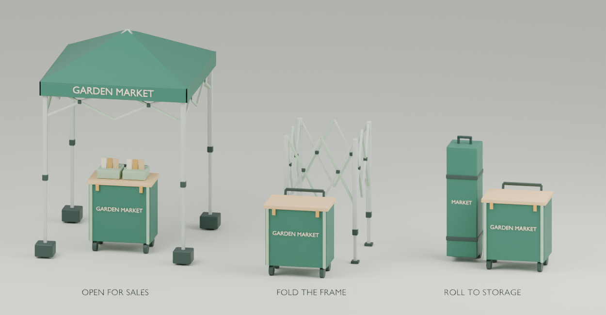
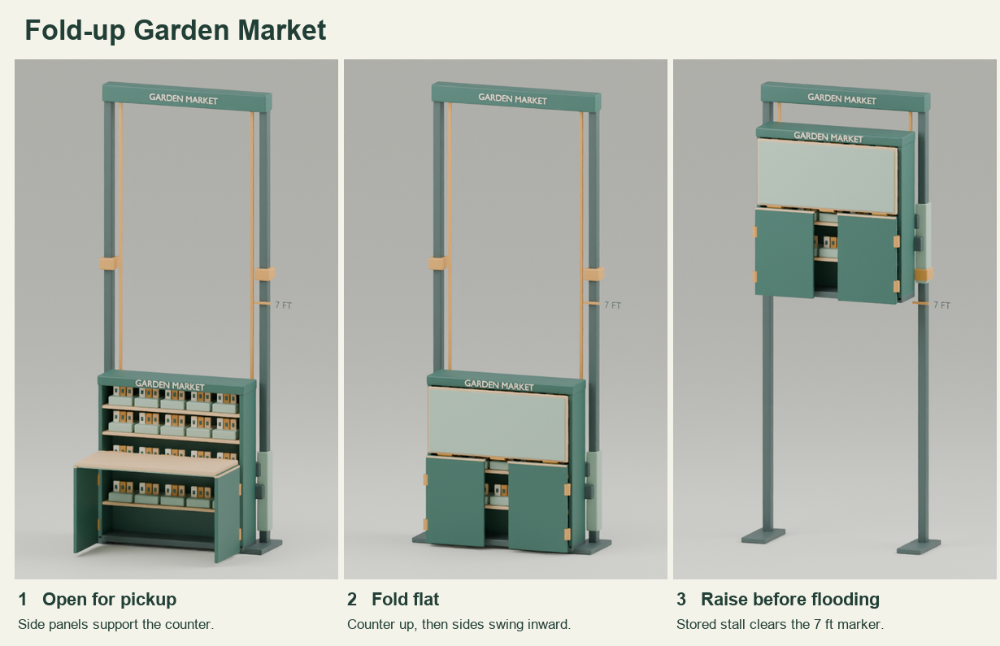

# Fold-out Garden Market

## Portable tent-style market

The [editable Blender scene](portable/portable-market.blend) pairs a 5 ft square pop-up canopy with a locking stock trolley. Its lid is the sales counter. During an early preparation notice, staff can stow the trays, pack the canopy and roll the kit to a designated dry location while conditions allow. An evacuation instruction ends packing immediately. The counter stays at everyday working height, about 80 cm. Choose a dry storage location and a clear, step-free route before the trial. Include the fabric, ballast, stock and case when weighing the kit and timing a two-person drill. The canopy mechanism is based on a [commercial 5 ft frame with roller bag](https://www.eurmax.com/products/standard-5x5-canopy-frame-with-heavy-duty-roller-bag).

## Earlier fixed-lift concept

Play frames 1 to 110 in the [animated Blender model](fold-lift/fold-lift.blend). The sales counter folds up, both supports turn inward, and the carriage lifts the stocked unit along two guides. Its lowest moving part parks 2.19 m above the floor, just over 7 ft. The stationary frame reaches about 3.95 m (13 ft). Seven feet is the proposed storage clearance. Site flood elevation, overhead space, heritage-compatible anchoring, lift capacity, guarding and a mechanical parking lock require engineering and site review before installation. The lift is a separate cost from the original cabinet estimate.

## Earlier cabinet concepts

Each Blender scene shows the same stall stored on the left and ready for customers on the right. Open a .blend file to inspect the parts or use a PNG directly in the slides.

| Design | How it opens | Main tradeoff |
| --- | --- | --- |
| [Drop-front counter](counter.blend) | The front cover lowers into a counter. Two folding, telescoping legs support its outer edge. Stock stays in its trays. | Our pick for a pilot. It needs clear space in front and gives one vendor a compact pickup counter. |
| [Side-wing stall](wings.blend) | The front becomes the checkout counter. Two side panels fold down onto brackets for extra displays. | More space for browsing, but the host needs a wider clear area and the vendor has more hardware to check. |
| [Bookcase stall](bookcase.blend) | Two stocked cabinets close face to face. One swings out on a vertical hinge so customers can browse both sets of trays. | More display space, but the swing needs clearance and there is no dedicated checkout counter. |

These are concept models. A physical trial should check setup time, stability, customer reach and the space left for the aisle. Compare the drop-front cabinet with a folding table and bins using the same stock.

