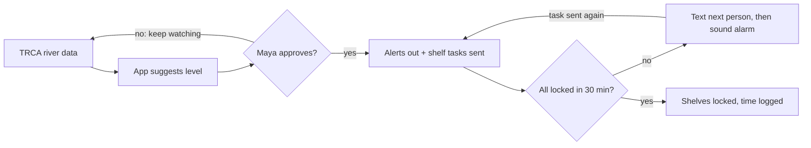

# Yellow Zone Solution Plan: Foldable Shelves + Flood Warning App (Detailed)

Our solution protects Garden Market stock from floods with foldable, latched shelves that keep reserve stock high every day. A warning app makes sure staff and vendors finish folding and loading before the water comes. A drill-tested pilot proves it works, for $100,000 over 12 months.

Short version: [PLAN-SIMPLE.md](PLAN-SIMPLE.md)

---

## 1. Problem and goal

The goal is zero lost Garden Market stock in the next flood, with nobody staying behind to save it. Evergreen already manages stormwater and lets floodwater pass through the ground floors on purpose. That protects the buildings, but not goods sitting on the floor.

In September 2026, Outward Bound Canada at the Brick Works raised its gear about 3 ft and still lost much of it when the water rose higher ([Outward Bound Canada, 2026](https://www.outwardbound.ca/blog/outward-bound-canada-toronto-flood-2026/)). So the shelf height must come from real flood modelling, and stock must move early.

## 2. Part 1: The foldable shelves

Foldable shelves keep reserve stock high every day, so protection doesn't depend on a last-minute rush.

- **What:** 2 installed cabinet modules (the pilot can grow to 4) with fold-down, pull-down shelves similar to Kesseboehmer iMove. Shelves fold down so people can reach them, then lock back up with a latch.
- **Trays:** one removable tray serves as the display, the cart load and the stored unit. Staff move whole trays, never single items.
- **Height:** set from a site survey and TRCA flood modelling, not a guess.
- **Safety:** cabinets are restrained so floodwater can't tip them over. They stand clear of the heritage walls and work without power.
- **Covers:** light, water-sensitive goods only. Heavy pots, soil, big plants and fridges are outside the pilot.
- **Load limit:** about 8 kg per lift mechanism, so trays carry a labelled weight cap.

**To do**

1. Site survey and flood-height modelling.
2. Engineered cabinet design that respects the heritage building.
3. Build and test one prototype with vendors.
4. Get quotes, then install 2 modules.
5. Make trays, carts and washable display parts.

## 3. Part 2: The flood warning app

### 3a. What the app does

The app makes sure the foldable shelves are folded up and loaded before the water arrives. Shelves only protect stock if someone lifts them in time, and the September 2, 2026 flood hit overnight. So the app has one job: turn a flood warning into a short shelf checklist, track who has finished it, and tell everyone else what is happening.

It is a mobile web app with no app store, plus a staff dashboard and the public screen at the Welcome Centre. It uses TRCA's free real-time river data.

### 3b. Who uses it

| Person | What they see | What they do |
| --- | --- | --- |
| Maya (staff) | Dashboard: alert level, shelf checklist per cabinet, who has finished | Approves the alert, assigns shelf tasks, marks the site closed or reopened |
| Aisha (vendor) | Text + app card: "Fold and load your shelves by 6 PM" | Taps "Done" once her trays are up, adds a photo |
| Daniel (visitor) | Public status page and Welcome Centre screen: Open, Watch or Closed | Checks before leaving home, opts in to texts |
| Marcus (organizer) | The same status page, plus an email when his event date is at risk | Moves or confirms his event early |

Gap: Daniel and Marcus get information, not protection. That's fine for this pilot, since the shelves are for stock.

### 3c. App features for the pilot

1. **River watch.** Pulls Don River levels and rainfall from TRCA every 15 minutes and suggests Green, Yellow or Red.
2. **Staff approval.** Maya (or the on-call staff member) approves before any public alert goes out.
3. **Shelf checklist.** One card per cabinet: fold up, load trays, lock the latch, take a photo.
4. **Escalation.** If a task isn't done within 30 minutes, the app texts the next person on the call list, then sounds the on-site alarm.
5. **Alerts out.** One approved message goes to the app, opt-in texts and the Welcome Centre screen at the same time.
6. **Pilot log.** Records how long each fold-and-load took and how many tasks were missed.

Left out on purpose: maps, vendor sales tools, visitor accounts, AI chat, and native iPhone or Android apps.

### 3d. How a warning flows

### 3e. Screens

| Screen | Who | What is on it |
| --- | --- | --- |
| Status home | Everyone | Big colour badge (Green, Yellow, Red), one line of advice, last updated time |
| Approve alert | Maya | River level vs. trigger line, suggested message, Approve or Edit button |
| Shelf checklist | Maya, Aisha | Cabinet cards with fold, load, latch and photo steps; red until done |
| Who is missing | Maya | List of unfinished tasks with a Call or Text button |
| Welcome Centre screen | Daniel, Marcus | Site status, which spaces are open, when it was updated |

### 3f. Tech stack (suggested, no quotes yet)

| Part | Suggested tool | Why |
| --- | --- | --- |
| App and dashboard | Progressive web app (opened from a link or QR code) | One build for phones and laptops |
| Database and logins | Supabase or Firebase | Free tier fits a pilot; logins for staff only |
| River data | [TRCA real-time flood monitoring](https://trcagauging.ca/) | Free |
| Texts | Twilio or a Canadian SMS provider | Pay per text, opt-in only |
| Public screen | Status page in kiosk mode | Same page as the website |
| On-site alarm | Small internet relay wired to the battery-backed alarm | The alarm still works by hand if Wi-Fi or power fails |

Open question: we haven't confirmed that TRCA offers a public developer API. Ask TRCA early, and build a manual "staff enters the level" fallback.

## 4. Part 3: Drills, training and permits

1. **Approvals first.** Evergreen sign-off, heritage review and TRCA permit review come before anything is fixed to a floor. The site is in a regulated floodplain ([TRCA Regulated Area viewer](https://experience.arcgis.com/experience/1a3f466a3d014cd8aac79421df381c53)).
2. **Training.** Staff and vendors learn to fold, load, latch and log in the app. This includes an accessibility check of the shelves, screen and alarm.
3. **Sign-ups.** QR signs and briefing sheets get vendors and visitors onto the text alerts.
4. **Drill.** A fake Red alert at month 6, timed against the current way of storing stock.
5. **Evacuation rule.** Once evacuation starts, nobody handles stock.
6. **Partners to ask (none confirmed yet):** Evergreen staff time and floor space, TRCA data access, supplier pilot pricing, and vendors as free testers.

## 5. Budget (whole project)

| Category | What it pays for | Cost (CAD) |
| --- | --- | --- |
| Materials and equipment | 2 cabinet modules $14K, prototype $7K, trays and carts $7K, washable displays $5K, public screen $6K, alarms and battery backup $4K | $43,000 |
| Technology and software | App build $22K; year-one hosting, texts and fixes $4K | $26,000 |
| Research and data | Site survey, flood modelling, cabinet design | $10,000 |
| Staffing | Training and accessibility review | $5,000 |
| Admin | Heritage and TRCA permit review, insurance, accounting | $3,500 |
| Outreach | Text sign-up signs, briefing sheets, QR tray labels | $2,500 |
| Travel | Site visits for the review and the drill | $1,000 |
| Contingency | 9.9% buffer | $9,000 |
| **Total** | | **$100,000** |

App split (an estimate, not quoted): prototype $4K, build $12K, text/screen/alarm links $3K, testing $3K, then year-one hosting $1K, texts $1.5K and fixes $1.5K. The $7,000 per cabinet is also unquoted.

## 6. Timeline and pilot test

1. **Months 1 to 2: Design.** Site survey, flood modelling, cabinet design, permit review, app sketches and a clickable prototype. Ask TRCA about data access.
2. **Months 3 to 5: Build.** Shelf prototype, install 2 modules, trays and carts, the app, texts, screen and alarm link. Train staff and vendors.
3. **Month 6: Drill.** A fake Red alert using the real shelves.
4. **Months 7 to 12: Live pilot.** Real alerts, a monthly review, and fixes.

What the drill measures:

- Minutes from alert approval until every shelf is locked. Target: under 30.
- Number of shelf tasks missed or late.
- Share of vendors and staff who got the text within 5 minutes.
- Number of visitors who signed up for texts.

## 7. Risks, plainly

- **A flood higher than the shelves.** Fix: set the height from modelling, restrain the cabinets, and move stock out early.
- **Overnight floods.** Fix: keep reserve stock folded up every night by default.
- **Nobody answers.** Fix: the escalation chain and the on-site alarm.
- **No TRCA data access.** Fix: staff enter the river level by hand.
- **Safety first.** Nobody stays behind to save stock once evacuation starts.
- **Software outweighs shelves.** $26K on the app versus $14K on cabinets. Answer: the app is built once and reused for every future cabinet and building.
- **Year two is unfunded.** About $4,000 a year in running costs, and nobody has agreed to pay it yet.
