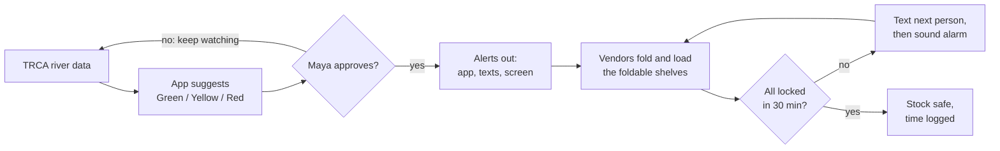
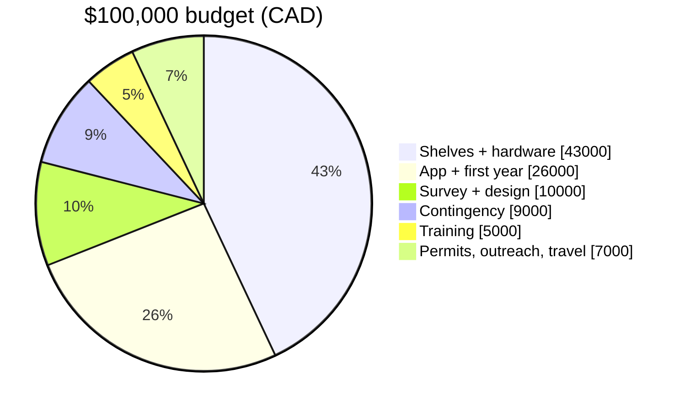
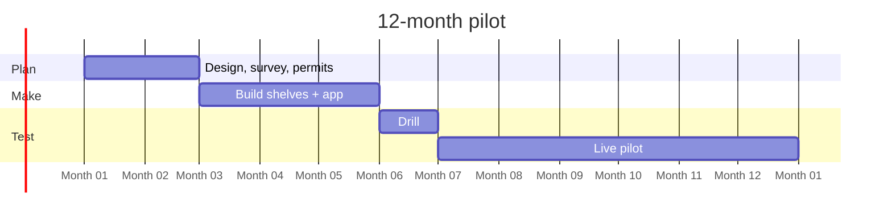

# Yellow Zone Solution: The Simple Version

[Compare the proposed Fold-Out Garden Market pilot and updated financial plan](FOLD-OUT-PILOT.md). The team is reviewing the two scopes.

**Foldable shelves + a flood warning app + a practised drill = no Garden Market stock lost to the next flood.**

*(The Gantt uses example months. Shift them to the real start date.)*

## In bullets

- **Problem:** Evergreen's flood design protects the buildings, not the stock on the floor. The Garden Market lost stock in July 2024, and the site flooded again on September 2, 2026.
- **Part 1, the shelves:** 2 foldable, latched cabinet modules. Reserve stock stays up high on removable trays every night.
- **Part 2, the app:** it watches TRCA river data, Maya approves, vendors get a fold-and-load checklist, and texts plus an alarm chase anyone who hasn't finished.
- **Part 3, the drill:** staff and vendors practise. The goal is every shelf locked within 30 minutes.
- **Visitors and organizers:** a public status page and the Welcome Centre screen show whether the site is open.
- **Budget:** $100,000 over 12 months.
- **Success:** shelves locked in under 30 minutes, no missed tasks, and no stock lost.
- **Biggest risks:** a flood higher than the shelves, an overnight flood with nobody on site, and no funding confirmed for year two.

Full plan: [PLAN-DETAILED.md](PLAN-DETAILED.md)
