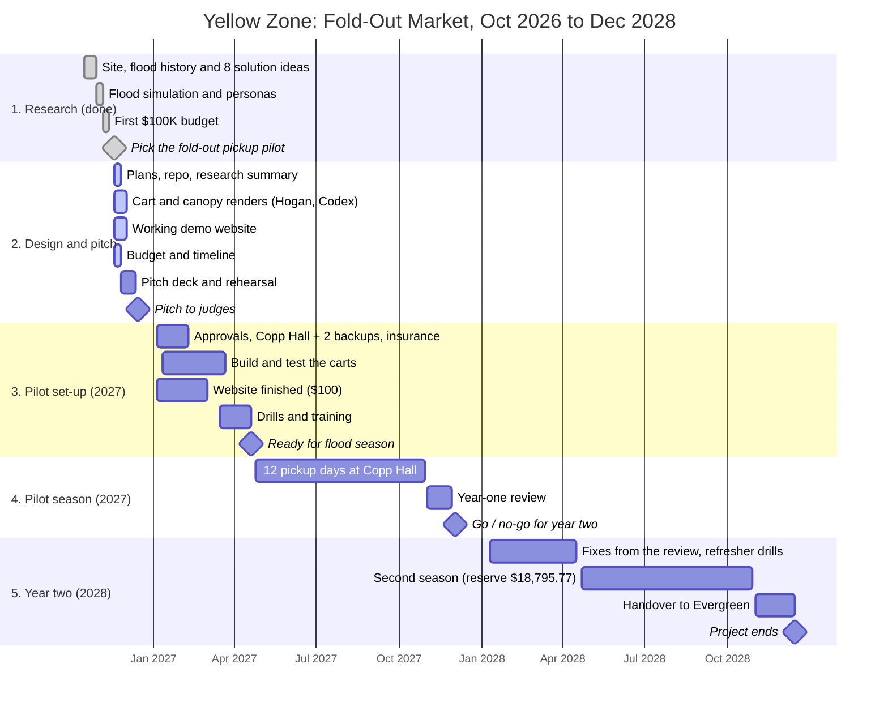

# Timeline: the whole Yellow Zone project

This runs from the first research in October 2026 to the end of year two in 2028. **Dates after today (18 Nov 2026) are planned, not booked.**
- The **judges' pitch is assumed for mid-December 2026.**
- The **pilot is assumed to start in January 2027.** If either date moves, shift everything after it by the same amount.
- The pilot has to be ready **before spring flood season** (snowmelt and spring storms, March to April), and it then runs through the summer storm months. The July 2024 flood is the one we are planning for.

## The whole project at a glance

## Stages

| Stage | When | What happens | Who |
| --- | --- | --- | --- |
| 1. Research | Oct to mid-Nov 2026 (done) | Studied the Brick Works floods and wrote 8 ideas, dropping the ones Evergreen already does. Built the flood simulation and personas, drafted the first $100K budget, then picked the fold-out pickup pilot on 18 Nov. | Team, Claude |
| 2. Design and pitch | 18 Nov to mid-Dec 2026 | Unified plan, repo and research summary. Hogan's push-bar cart and canopy renders. The working demo website. The $100K budget and this timeline. Then the deck and rehearsals before the judges. | Gopi, Hogan, Codex, Claude |
| 3. Pilot set-up | Jan to mid-Apr 2027 | See the pilot detail below. | Team with Evergreen |
| 4. Pilot season | Late Apr to Dec 2027 | See the pilot detail below. | Team with Evergreen and vendors |
| 5. Year two | 2028 (only if December 2027 says go) | Apply fixes from the review, run refresher drills before spring, then a second season paid from the $18,795.77 reserve. Hand the carts, website and checklists to Evergreen by December 2028. | Evergreen, with the team handing over |

## Pilot detail (2027)

| Phase | When | What gets done | Money (see [BUDGET.md](BUDGET.md)) |
| --- | --- | --- | --- |
| 1. Approvals | Jan 2027 (5 weeks) | Evergreen signs off on the pilot. The church gives a written quote covering room, storage, weekend custodial fees and short-notice access. Host agreement and liability insurance are in place. | Admin $2,300; storage retainer starts ($275/month) |
| 2. Cart and canopy | Jan to Mar (10 weeks) | Lock Hogan's push-bar cart design. A professional checks stability and accessibility. Build and load-test the prototype, then build the second cart and buy canopies, stock and card readers. | Materials $7,838; design review $3,600; fabrication $7,200 |
| 3. Website | Jan to Mar (8 weeks, in parallel) | Codex finishes the outage fixes and approval records. The team tests the site with users who rely on large print and screen readers. A domain goes live on free hosting. | Website $100 (student hours in kind) |
| 4. Drills and training | Mid-Mar to mid-Apr (5 weeks) | Train staff and vendors. Run 4 timed drills, comparing the cart with a plain folding table and bins. Put signs and QR cards up at the Brick Works and Copp Hall. | Coordination $4,400; trials $1,030; outreach $1,500 |
| 5. Pickup season | Late Apr to Oct (27 weeks) | 12 booked market days at Copp Hall, plus a pickup whenever a flood closes the shop. Inspect the carts monthly. | Hall $19,200; backup hosts $8,840; staffing $3,072; van $2,160; inspections $864 |
| 6. Review | Nov 2027 (4 weeks) | Compare sales, drill times and costs with the plan. Decide whether to release the year-two reserve, change the plan or stop. | Year-two reserve $18,795.77 held until this point |

## Checkpoints that can stop or change the plan

- **Mid-December 2026, the pitch:** the judges' feedback goes into the plan before any money is spent.
- **End of January 2027:** no written answer from Copp Hall means a backup host (Yorkminster Park or Church of the Redeemer) becomes the main host before anything is built.
- **Mid-March:** if the prototype fails its stability or doorway test, fix it before drills start, or use the folding table and bins for this season.
- **Mid-April:** if the cart isn't faster or safer than a folding table and bins in the drills, build no more and run the season with the cheaper setup.
- **December 2027:** the reserve is released only if the stall was used and the drills passed.
