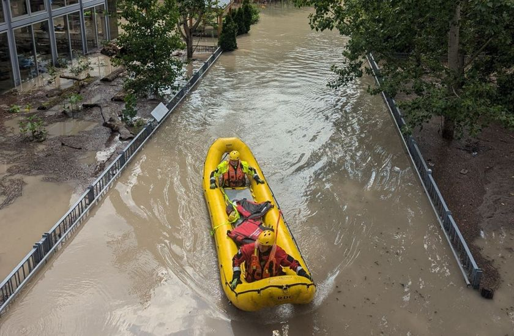
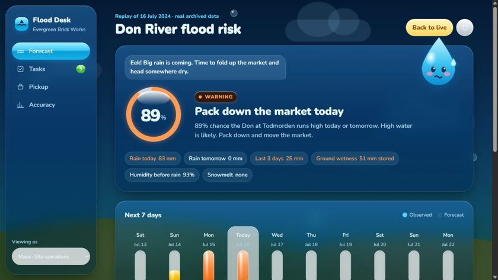
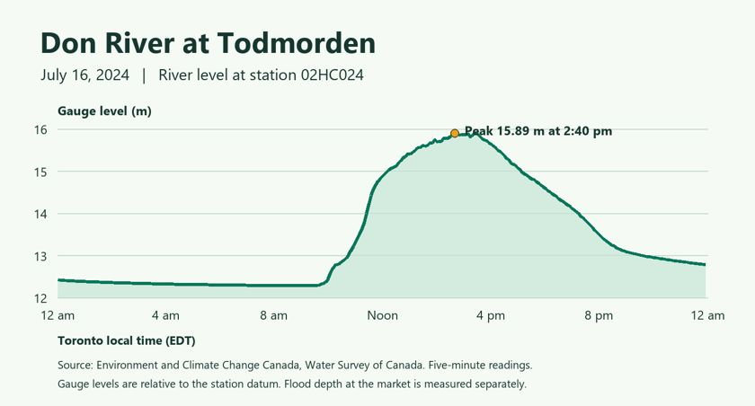
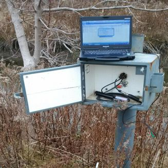
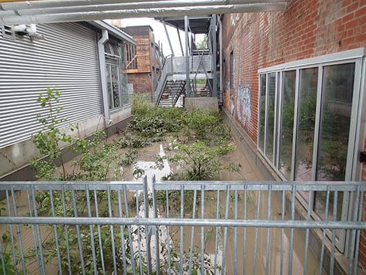
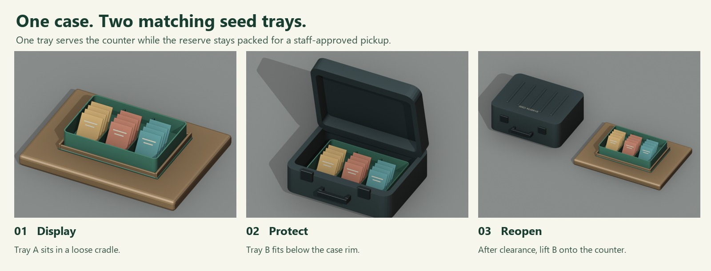

# MMHS Team 3 | One Up Official

## Agreed pitch | November 24, 2026

We are asking for CAD $2,422.46 to test the sample-only display and to log the opening decision on every market morning, including quiet mornings. CAD $100,000 is the competition ceiling. Off-site pickup depends on the results and a written host agreement. The older $81,104.23 year-one schedule, $100 website and $18,795.77 reserve belong to that later option. The school workbook’s $6,403.59 maximum covers the first test and all conditional small fixes. It is a different scenario from off-site pickup, and only $2,422.46 is requested now. [Agreed budget](https://github.com/ethan-gobi/1UP-App/blob/1238e64/docs/BUDGET.md)

### July 16 replay and the opening decision

The team reconstructed a 29% Watch using archived forecasts and an assumed 07:00 Toronto cutoff. The 95% retrospective score used rain that actually fell. TRCA’s Water Safety statement was already in effect at 07:00. TRCA upgraded it to Flood Watch at 09:35 and Flood Warning at 11:35. We lack the issue time of the ECCC rainfall warning. This example shows how staff could consider a Watch, but the evidence cannot establish whether the model changed the opening decision. The live pilot should use the actual staff setup decision time each day. [Forecast replay](https://github.com/ethan-gobi/1UP-App/issues/13#issuecomment-7144687308) · [TRCA event report](https://pub-trca.escribemeetings.com/filestream.ashx?DocumentId=17893)

## Financial plan | CAD

| Phase-one item | Quantity | Rate | Before HST | HST | Total | Price basis |
|---|---:|---:|---:|---:|---:|---|
| Prepare paired displays, replay cases and STOP script | 12 | 35.00 | 420.00 | 0.00 | 420.00 | Planning estimate |
| Practice crew, observers and order timer | 18 | 30.00 | 540.00 | 0.00 | 540.00 | Planning estimate |
| Accessibility reviewer | 4 | 100.00 | 400.00 | 52.00 | 452.00 | Planning estimate |
| Participant honoraria | 12 | 25.00 | 300.00 | 0.00 | 300.00 | Planning estimate |
| Low-cost seed display, trays and mock reserve box | 1 | 65.00 | 65.00 | 8.45 | 73.45 | Planning estimate |
| [APEX rechargeable handheld megaphone](https://www.long-mcquade.com/144136/Pro-Audio-Recording/PA-Speaker-Cabinets/Apex-Electronics/MegaUSB-Square-Horn-Megaphone.htm) | 1 | 109.99 | 109.99 | 14.30 | 124.29 | Published Canadian price |
| Printed directions and reusable floor stands | 2 | 35.00 | 70.00 | 9.10 | 79.10 | Planning estimate |
| Plain-language drill cards and large-print copies | 1 | 40.00 | 40.00 | 5.20 | 45.20 | Planning estimate |
| [Local fieldwork transit](https://www.ttc.ca/Fares-and-passes) | 12 | 2.35 | 28.20 | 0.00 | 28.20 | Published Canadian price |
| Score shopper outcomes and historical trigger decisions | 4 | 35.00 | 140.00 | 0.00 | 140.00 | Planning estimate |
| Official alert and model replay using existing equipment | 1 | 0.00 | 0.00 | 0.00 | 0.00 | School resource |
| Classroom space and equipment | 1 | 0.00 | 0.00 | 0.00 | 0.00 | School resource |

Direct costs total **$2,202.24** including applicable HST. A 10% contingency adds **$220.22**, bringing the request to **$2,422.46**. By activity, $1,460.85 covers free browsing, $270.00 covers the official-alert comparison and $471.39 covers the separate STOP and first-turn check. [School financial workbook](https://docs.google.com/spreadsheets/d/1rzuIK60WiC27dHC7OgbuWunnBS91vdxT/edit)

### What each line pays for

1. 12 coordinator hours at $35: seven for free browsing, four for matching official alerts and model outputs to historical cases, one for the safety check.
2. 18 paid staff-hours at $30: 12 for setup and observations, two to check timestamps and replay decisions, four for STOP and first-turn coverage.
3. Three reviewer hours cover the two shopping layouts; one hour covers barriers during the safety check.
4. Twelve people browse both displays and may choose any variety or buy nothing. One honorarium per person.
5. Use identical mock stock for both runs. Display sample packets on Watch and retain the rest in the low-cost labelled box before opening.
6. Portable source for a clearly announced dry drill. No connection to a site alarm.
7. Classroom print and stand allowance. Place directions above eye-catching clutter.
8. One print run for variety and price cards, purchase/no-purchase tallies, accessible instructions and observation sheets.
9. Six students taking one return trip, at the TTC youth fare.
10. Four coordinator hours at $35, split evenly between scoring shopping outcomes and comparing replay decisions.
11. The staff lead reviews the official signal and then the model-assisted decision for identical past dates. No live warning, hosted app or paid data feed.
12. School room and timer used during a supervised practice. On-site use requires permission.

## Proposal

### A Watch Before the Market Opens

Evergreen Brick Works · Yellow Zone · MMHS Team 3

#### How might we

How might Garden Market staff use an early sign of high river flow to put less stock in harm’s way and still serve a customer on time if the storm passes?

In 2023 the Garden Market lost thousands of dollars of inventory. The brief gives no breakdown by product. Seed packets give us a small, water-sensitive item we can count and price in a school trial. In July 2024, Evergreen sounded its evacuation alarm at 11:30 a.m. and water rushed in around noon. By then, staff had people to look after. Our proposal moves the stock decision to opening time. [1UP brief, page 9](https://drive.google.com/file/d/14Rl44HuVojRxsoQ_Y9oa5bF9pOqWTeke/view) · [Evergreen’s July flood account](https://www.evergreen.ca/news/flooding-at-evergreen-brick-works-shows-a-need-for-more-climate-ready-spaces/)

#### What staff do with a Watch

**Review the signal.** Before setup, the site lead checks our model’s high-flow estimate, official warnings, the current river gauge and conditions on site. The model estimates whether average flow at Todmorden will reach 20 cubic metres per second today or tomorrow. A Watch prompts a staff review. Staff retain authority to open, delay setup or close.

**Change what goes on the counter.** If staff decide to open with precautions, the vendor displays one sample per variety. Sale packets stay sorted in labelled bins in a place staff have assessed for flood exposure, accessible reach and safe handling. Customers choose from samples. If suitable storage is unavailable, limit how much stock comes to the site in the first place. At the morning briefing, staff identify who announces STOP, who guides visitors and which route staff have checked. Portable signs and a removable tray keep fixtures off historic walls and out of drainage paths.

**If the storm passes.** Staff keep serving from the bins, record extra setup time, customer waits and any unfilled orders, then return to normal setup when the site lead clears it. The cost of this routine matters. In the historical test, Watch flagged 16 of 20 high-flow events a day ahead and averaged 13.3 false-alarm days per year. It used the next day’s measured rain. A live forecast introduces additional error. [Model methods and results](https://github.com/ethan-gobi/1UP-App/blob/a86f53796928a7a1d7ea26f8e39f6a1e4bf8131c/model/README.md)

**If conditions worsen.** The site lead follows official procedures. A closure announcement overrides setup instructions. Stock stays behind. Visitors hear the destination and can follow staff and a visible cue without opening a phone.

#### Would customers still browse the Watch display?

Twelve shoppers try both mock displays. Six see Normal first and six see Watch first. Give each person the same pretend spending allowance on both visits. They may browse, choose any variety, change their mind or leave without buying. Keep the vendor’s welcome, prices, varieties, labels, time available and starting inventory of 40 packets the same. Reset the stock and allowance between visits. The Normal counter holds sale packets. The Watch counter shows one sample per variety, and the vendor fills requests from protected stock.

Record each shopper’s two choices side by side. Count people who choose a packet in both visits, only in Normal, only in Watch or in neither. Record how many packets they select, their mock basket value, time spent browsing, questions and time from request to handoff. Ask one neutral question after each visit: What influenced your choice? A no-buy visit counts in the purchase comparison and has no handoff time. Note whether seeing the first display influenced the second visit. Twelve paired visits in each condition can reveal a design problem; they cannot establish an effect on actual sales.

For stock exposure, run an identical short order sequence with both setups, resetting the starting stock each time. Use the same people, prices and STOP point, and alternate setup order. Include Normal with a surprise STOP and no earlier warning. Separating this check from free browsing prevents differences in what shoppers happened to buy from deciding which layout has less stock left out. Record setup minutes, completed orders, waits, exposed sale packets by variety and value at posted prices, plus any handling after STOP. Nobody moves stock during closure.

**Decision.** Aim for Watch exposure of at most 25% of Normal’s sale packets, the same scripted orders filled, median handoff within 30 seconds of Normal and zero handling after STOP. Review the browsing choices and no-buy reasons alongside those targets. If samples discourage browsing or make buying harder, revise the display and repeat before proposing an on-site pilot. The site lead and vendor judge whether the reduction in exposure justifies extra work on false-alarm days. Report mixed or inconclusive results as such.

#### Would the model change the opening decision?

Compare two staff decisions at the same pre-opening time. First show the official flood messages covering the Don watershed and the gauge and site information staff could actually see then. Record the choice and why. Then add only the team model’s timestamped high-flow estimate and record whether anything changes. Both versions follow official instructions. A team Watch may prompt a more cautious display; it cannot cancel a warning or authorize reopening.

Choose the dates, decision time and decision rules in advance. Include all eligible opening days in the chosen period, including rainy days that stayed open and days without high flow. Use a fixed model version whose training and tuning end before those dates. Record when each forecast run, bulletin and gauge reading became available. Only include inputs delivered by decision time. Later measured rain, revised readings and warnings issued after opening may be used to score what happened, never to recreate what staff knew. Missing records make a day unscorable.

For the same days, tally high-flow events noticed in time and misses under each approach. Also tally extra Watch setups on days without high flow, any added useful notice before setup, and the measured burden of those extra mornings. Count contiguous high-flow days as one event and extra setups by opening day. Score daily mean flow of at least 20 m³/s at Todmorden today or tomorrow separately from any documented Garden Market closure or stock impact. If official signals already support the same timely choices, staff gain no demonstrated advantage from adding the model.

If timed archives cannot be matched, start a prospective shadow log on upcoming openings. Save the official messages, gauge view, forecast issue and receipt times, model version, estimate and both choices before outcomes are known. Record ordinary days as well as storms. Staff continue using their established procedures. Review the results after enough varied openings to inform the choice. Until then the historical 16-of-20 figure is background, not evidence of added value at the market. [TRCA’s flood message definitions](https://trca.ca/conservation/flood-risk-management/flood-forecasting-warning/) · [Issued forecast runs and archive coverage](https://open-meteo.com/en/docs/single-runs-api) · [Availability and revision of federal gauge data](https://wateroffice.ec.gc.ca/report/real_time_e.html?stn=02HC024)

#### Design constraints

| Factor | What it means for the pilot |
| --- | --- |
| Budget | Fund the shopper and warning comparisons first. Only release additional funds for a problem that persists after a low-cost adjustment. |
| Time | Keep equipment out of exit paths. All packing stops as soon as staff order a closure. |
| Structural concerns | Use a removable cradle on the counter. Check its stability, reach and footprint. The retrofit needs no drilling into heritage walls. |

#### Two smaller checks

**Directions.** A separate dry walkthrough tests what people do after a staff closure. Compare a spoken destination and the usual labels with the same message plus an arrow and guide. Record the first turn, unprompted recall and any access barrier. It tells us about that junction under practice conditions.

**Recovery.** A reserve case could support a limited pickup after staff and a host approve access, staffing and inventory. Open the pre-stocked case, lift the divided tray and place it in the counter cradle. Test against an ordinary labelled bin. Nobody retrieves either during closure. Leaside Gardens is a candidate only. A public service would require a separate agreement and operating budget.

#### What the pilot buys

The first stage costs **CAD $2,422.46**. It allocates $1,460.85 to the shopper and display comparison, $270.00 to comparing the two warning approaches, $471.39 to the secondary STOP and first-turn check, and $220.22 to shared contingency. Record who will review each result, including the vendor who works the display. Revisit the plan after each supervised trial and before the next market season.

Three optional fixes include a retest: audio (CAD 1,465.50), directions and accessibility (CAD 1,118.70), and reserve-stock equipment (CAD 1,396.93). Only release funds for an observed problem that remains after a cheaper change. A reserve case also needs approved dry storage and zero post-STOP packing. The maximum including the first pilot and all three options is CAD 6,403.59. [School financial plan](https://docs.google.com/spreadsheets/d/1rzuIK60WiC27dHC7OgbuWunnBS91vdxT/edit)

## Research notes and sources

### Research behind the Watch opening

#### What staff do with a Watch

**Review the signal.** Before setup, the site lead checks our model’s high-flow estimate, official warnings, the current river gauge and conditions on site. The model estimates whether average flow at Todmorden will reach 20 cubic metres per second today or tomorrow. A Watch prompts a staff review. Staff retain authority to open, delay setup or close.

**Change what goes on the counter.** If staff decide to open with precautions, the vendor displays one sample per variety. Sale packets stay sorted in labelled bins in a place staff have assessed for flood exposure, accessible reach and safe handling. Customers choose from samples. If suitable storage is unavailable, limit how much stock comes to the site in the first place. At the morning briefing, staff identify who announces STOP, who guides visitors and which route staff have checked. Portable signs and a removable tray keep fixtures off historic walls and out of drainage paths.

**If the storm passes.** Staff keep serving from the bins, record extra setup time, customer waits and any unfilled orders, then return to normal setup when the site lead clears it. The cost of this routine matters. In the historical test, Watch flagged 16 of 20 high-flow events a day ahead and averaged 13.3 false-alarm days per year. It used the next day’s measured rain. A live forecast introduces additional error. [Model methods and results](https://github.com/ethan-gobi/1UP-App/blob/a86f53796928a7a1d7ea26f8e39f6a1e4bf8131c/model/README.md)

**If conditions worsen.** The site lead follows official procedures. A closure announcement overrides setup instructions. Stock stays behind. Visitors hear the destination and can follow staff and a visible cue without opening a phone.

#### Would customers still browse the Watch display?

Twelve shoppers try both mock displays. Six see Normal first and six see Watch first. Give each person the same pretend spending allowance on both visits. They may browse, choose any variety, change their mind or leave without buying. Keep the vendor’s welcome, prices, varieties, labels, time available and starting inventory of 40 packets the same. Reset the stock and allowance between visits. The Normal counter holds sale packets. The Watch counter shows one sample per variety, and the vendor fills requests from protected stock.

Record each shopper’s two choices side by side. Count people who choose a packet in both visits, only in Normal, only in Watch or in neither. Record how many packets they select, their mock basket value, time spent browsing, questions and time from request to handoff. Ask one neutral question after each visit: What influenced your choice? A no-buy visit counts in the purchase comparison and has no handoff time. Note whether seeing the first display influenced the second visit. Twelve paired visits in each condition can reveal a design problem; they cannot establish an effect on actual sales.

For stock exposure, run an identical short order sequence with both setups, resetting the starting stock each time. Use the same people, prices and STOP point, and alternate setup order. Include Normal with a surprise STOP and no earlier warning. Separating this check from free browsing prevents differences in what shoppers happened to buy from deciding which layout has less stock left out. Record setup minutes, completed orders, waits, exposed sale packets by variety and value at posted prices, plus any handling after STOP. Nobody moves stock during closure.

**Decision.** Aim for Watch exposure of at most 25% of Normal’s sale packets, the same scripted orders filled, median handoff within 30 seconds of Normal and zero handling after STOP. Review the browsing choices and no-buy reasons alongside those targets. If samples discourage browsing or make buying harder, revise the display and repeat before proposing an on-site pilot. The site lead and vendor judge whether the reduction in exposure justifies extra work on false-alarm days. Report mixed or inconclusive results as such.

#### Would the model change the opening decision?

Compare two staff decisions at the same pre-opening time. First show the official flood messages covering the Don watershed and the gauge and site information staff could actually see then. Record the choice and why. Then add only the team model’s timestamped high-flow estimate and record whether anything changes. Both versions follow official instructions. A team Watch may prompt a more cautious display; it cannot cancel a warning or authorize reopening.

Choose the dates, decision time and decision rules in advance. Include all eligible opening days in the chosen period, including rainy days that stayed open and days without high flow. Use a fixed model version whose training and tuning end before those dates. Record when each forecast run, bulletin and gauge reading became available. Only include inputs delivered by decision time. Later measured rain, revised readings and warnings issued after opening may be used to score what happened, never to recreate what staff knew. Missing records make a day unscorable.

For the same days, tally high-flow events noticed in time and misses under each approach. Also tally extra Watch setups on days without high flow, any added useful notice before setup, and the measured burden of those extra mornings. Count contiguous high-flow days as one event and extra setups by opening day. Score daily mean flow of at least 20 m³/s at Todmorden today or tomorrow separately from any documented Garden Market closure or stock impact. If official signals already support the same timely choices, staff gain no demonstrated advantage from adding the model.

If timed archives cannot be matched, start a prospective shadow log on upcoming openings. Save the official messages, gauge view, forecast issue and receipt times, model version, estimate and both choices before outcomes are known. Record ordinary days as well as storms. Staff continue using their established procedures. Review the results after enough varied openings to inform the choice. Until then the historical 16-of-20 figure is background, not evidence of added value at the market. [TRCA’s flood message definitions](https://trca.ca/conservation/flood-risk-management/flood-forecasting-warning/) · [Issued forecast runs and archive coverage](https://open-meteo.com/en/docs/single-runs-api) · [Availability and revision of federal gauge data](https://wateroffice.ec.gc.ca/report/real_time_e.html?stn=02HC024)

#### What the historical score can tell us

The team fitted a weather-only logistic regression on 2000–2015, selected the alert thresholds on 2016–2019 and tested once on 2020–2023. Its Watch flagged 16 of 20 Todmorden high-flow events a day ahead and averaged 13.3 false-alarm days a year. That backtest supplied the next day’s observed rain as if the weather forecast had been perfect. The shipped weights were refitted through 2023. Testing incremental value now therefore requires a frozen post-training evaluation and forecasts actually available by the decision time. [Model methods](https://github.com/ethan-gobi/1UP-App/blob/d556683755d00a9dbe60f512d560466ae72452ab/model/README.md) · [Historical results](https://github.com/ethan-gobi/1UP-App/blob/d556683755d00a9dbe60f512d560466ae72452ab/model/results.json)

TRCA already monitors forecasts and watershed conditions and issues official messages. Its Flood Outlook describes potential flooding; its Flood Watch describes possible flooding in specified areas. The team’s model Watch is an internal advisory. Open-Meteo’s Single Runs API retrieves forecasts by initialization time. Its stated coverage begins in March 2024 for one ECMWF model, and in April 2026 for most others. Confirm the exact model, fields and availability for the chosen dates. Environment and Climate Change Canada also notes that gauge readings may be posted later than their observation time and may be revised. [TRCA Flood Forecasting and Warning Centre](https://trca.ca/conservation/flood-risk-management/flood-forecasting-warning/) · [Open-Meteo archive coverage](https://open-meteo.com/en/docs/single-runs-api) · [ECCC gauge data notice](https://wateroffice.ec.gc.ca/report/real_time_e.html?stn=02HC024)

#### What happened on July 16, 2024?

Evergreen records an 11:30 a.m. evacuation alarm and water rushing onto the site around noon. Staff helped move 113 campers to a designated off-site location. People were already leaving during that half hour. [Evergreen’s account and photographs](https://www.evergreen.ca/news/flooding-at-evergreen-brick-works-shows-a-need-for-more-climate-ready-spaces/)

*Flooding at Evergreen Brick Works in July 2024. Photograph by Evergreen.*

#### Why test one seed display?

The competition brief reports thousands of dollars in Garden Market inventory losses in 2023. Evergreen lists seeds among its products. Packets let us test one small, countable part of the business. The brief gives no breakdown of losses by product.

[Evergreen Garden Market](https://www.evergreen.ca/evergreen-brick-work/activities/evergreen-garden-market/) · [Evergreen’s seed catalogue](https://www.evergreen.ca/wp-content/uploads/2026/02/garden-market-march-flyer.pdf) · [1UP brief, page 9](https://drive.google.com/file/d/14Rl44HuVojRxsoQ_Y9oa5bF9pOqWTeke/view)

#### What can feed an early warning?

Our model estimates whether the Don River at Todmorden will average at least 20 cubic metres per second today or tomorrow. The gauge gives us a regional high-water target. Flooding at a specific stall also depends on what happens at the site. The model combines station rainfall with weather inputs including humidity. The app separately displays the latest river flow alongside its weather forecast and can replay the July 2024 storm. [How we trained the model](https://github.com/ethan-gobi/1UP-App/blob/d556683755d00a9dbe60f512d560466ae72452ab/model/README.md) · [App screens and data](https://github.com/ethan-gobi/1UP-App/blob/d556683755d00a9dbe60f512d560466ae72452ab/app/README.md)

*Our Flood Desk running the archived July 2024 storm replay. Measured weather is used for this historical view. [Team app and replay instructions](https://github.com/ethan-gobi/1UP-App/blob/d556683755d00a9dbe60f512d560466ae72452ab/app/README.md)*

*Our chart of Water Survey of Canada readings. Todmorden gauge stage rose 2.60 m from 9 a.m. to noon EDT on July 16, 2024. Gauge elevation is measured against its own datum. Water depth at the Garden Market is a different measurement. [Federal gauge data](https://collaboration.cmc.ec.gc.ca/cmc/hydrometrics/www/UnitValueData/Stage/corrected/02/Stage.Working@02HC024.20110101_corrected.csv.xz) · [Station details](https://wateroffice.ec.gc.ca/station_metadata/reference_index_e.html?stnNum=02HC024)*

The team trained the model on 2000 to 2015, chose its alert levels using 2016 to 2019, and held back 2020 to 2023 for testing. Watch flagged 16 of 20 high-water events a day ahead, with 13.3 false-alarm days per year. Warning flagged 13 of 20 a day ahead, with 5.3 false-alarm days per year. The replay used the rain that actually fell the next day, as if the forecast had been perfect. A prospective trial will tell us what lead time staff can really use. [Team backtest results](https://github.com/ethan-gobi/1UP-App/blob/d556683755d00a9dbe60f512d560466ae72452ab/model/results.json)

Joining records by date gives each day its historical weather inputs and its high-water label from the Todmorden gauge. At forecast time the fitted model uses current and forecast weather inputs. The gauge card stays separate. [Open-Meteo historical weather](https://open-meteo.com/en/docs/historical-weather-api) · [Forecast data](https://open-meteo.com/en/docs) · [Team training code](https://github.com/ethan-gobi/1UP-App/blob/d556683755d00a9dbe60f512d560466ae72452ab/model/train.mjs)

*A stream-gauge hut in TRCA’s regional monitoring network. Photograph by TRCA.*

#### Where does water go?

A rain cistern in Tiffany Commons collects water on site. Beside several buildings, planted greenways slow runoff and direct it toward stormwater ponds. The counter cradle, signs and speakers can be moved without mounting them on heritage walls. Staff would choose staging spots that keep drainage channels and walking routes open. The app uses weather and a river gauge; the Commons cistern is an example of how the site manages runoff. [Tiffany Commons and the rain cistern](https://www.evergreen.ca/evergreen-brick-work/activities/the-tiffany-commons/) · [Evergreen’s greenways and cisterns](https://www.evergreen.ca/stories/managing-floods-with-green-design-at-evergreen-brick-works/)

*Planted greenway at Evergreen Brick Works. Photograph by Evergreen. [Source and site description](https://www.evergreen.ca/stories/managing-floods-with-green-design-at-evergreen-brick-works/)*

#### What visitors could return to

The outdoor Farmers Market returned July 20 while buildings remained closed for cleaning. The year-round Garden Market in the Yellow Zone is a separate operation. [1UP competition brief, pages 7 to 10](https://drive.google.com/file/d/14Rl44HuVojRxsoQ_Y9oa5bF9pOqWTeke/view) · [Evergreen’s reopening account](https://www.evergreen.ca/news/flooding-at-evergreen-brick-works-shows-a-need-for-more-climate-ready-spaces/)

#### What another flood-prone place does

At Zion National Park, a National Weather Service flash flood warning closes the Narrows. Staff also use measured Virgin River flow to determine when the trail is closed. The lesson for our pilot is to write down who can change operations and what visitors will hear when that happens. A threshold for hiking in Utah would need different evidence to guide a Toronto market. [National Park Service closure policy](https://www.nps.gov/zion/planyourvisit/conditions.htm)

*Hiking the Narrows in Zion National Park. Photograph by the U.S. National Park Service. [NPS photograph and visitor guidance](https://www.nps.gov/zion/planyourvisit/virgin-river-narrows-information.htm)*

#### Two smaller checks

**Directions.** A separate dry walkthrough tests what people do after a staff closure. Compare a spoken destination and the usual labels with the same message plus an arrow and guide. Record the first turn, unprompted recall and any access barrier. It tells us about that junction under practice conditions.

**Recovery.** A reserve case could support a limited pickup after staff and a host approve access, staffing and inventory. Open the pre-stocked case, lift the divided tray and place it in the counter cradle. Test against an ordinary labelled bin. Nobody retrieves either during closure. Leaside Gardens is a candidate only. A public service would require a separate agreement and operating budget.

#### What fits inside the case?

*Team Blender model. One tray sits on the market counter and its twin stays packed at a dry location. Either tray can be set out on an approved pickup table.*

Our loaded digital tray measures 360 × 240 × 92.7 mm with twelve example packets. The reference case base is 108 mm deep, giving about 15 mm of nominal headroom. A physical test needs real packets, the tapered corners, room for fingers and clearance for the lid to latch. Keep the reserve dry before a closure. Case dimensions alone cannot establish protection in a flood.

[NANUK Canada case specifications and price](https://nanukcases.ca/products/nanuk-925-empty) · [Manufacturer drawing](https://nanuk.eu/cdn/shop/files/925_Nanuk_Case_Specsheet_2025_EN.pdf)

#### Where could pickup run during a closure?

Leaside Memorial Community Gardens at 1073 Millwood Road is about 2 km from Brick Works in a straight line. The arena and the area immediately around it fall outside TRCA’s mapped river floodplain. Its wheelchair-accessible William Lea Room has tables and a published weekend rate of CAD 138 an hour for simple bookings. A two-hour window would cost CAD 276 before tax if the venue accepts pickup at that rate.

Before moving a case, Evergreen and the host would agree on secure storage, who holds the key, who staffs pickup and how to check access after a storm. The host would confirm availability and staff would count the reserve before publishing a pickup time. If roads are closed or the host cannot open, reservations stay paused. Visitors leaving Brick Works follow site staff; the pickup address is for a later order handoff.

[William Lea Room and published rates](https://leasidegardens.com/william-lea-room/) · [TRCA floodplain map](https://trca.ca/conservation/flood-risk-management/flood-plain-map-viewer/) · [Floodplain check around the arena](https://services1.arcgis.com/d0ZCwU7eGKVeNiEE/arcgis/rest/services/Floodline_TRCA_Polygon/FeatureServer/1/query?f=pjson&where=1%3D1&inSR=4326&geometryType=esriGeometryEnvelope&spatialRel=esriSpatialRelIntersects&returnCountOnly=true&geometry=-79.3621,43.7010,-79.3592,43.7030)

#### What the pilot buys

The first stage costs **CAD $2,422.46**. It allocates $1,460.85 to the shopper and display comparison, $270.00 to comparing the two warning approaches, $471.39 to the secondary STOP and first-turn check, and $220.22 to shared contingency. Record who will review each result, including the vendor who works the display. Revisit the plan after each supervised trial and before the next market season.

Three optional fixes include a retest: audio (CAD 1,465.50), directions and accessibility (CAD 1,118.70), and reserve-stock equipment (CAD 1,396.93). Only release funds for an observed problem that remains after a cheaper change. A reserve case also needs approved dry storage and zero post-STOP packing. The maximum including the first pilot and all three options is CAD 6,403.59. [School financial plan](https://docs.google.com/spreadsheets/d/1rzuIK60WiC27dHC7OgbuWunnBS91vdxT/edit)

## Five-minute presentation script

### A Watch Before the Market Opens

1UP · Evergreen Brick Works · MMHS Team 3

Slide 1 · 0:00 to 0:20

#### A Watch before the market opens

Picture Aisha putting paper seed packets on the Garden Market counter. If there’s a chance the river will run high, should she set out all her stock or show one sample of each variety? We want to test whether changing that one decision protects the stock while still giving people a display they want to shop.

Slide 2 · 0:20 to 0:50

#### What happened at Brick Works

On July 16, 2024, the Garden Market suffered considerable inventory losses. Evergreen hasn’t published a dollar total. TRCA had a Water Safety statement in force from the previous day. It issued a Flood Watch at 9:35 and a Flood Warning at 11:35, and it contacted Brick Works directly. From 9 a.m. to noon, the federal gauge at Todmorden recorded a 2.60-metre rise in the Don. That gives us a reason to change what is on the counter before conditions worsen.

Slide 3 · 0:50 to 1:25

#### What a Watch can tell us

Our model uses fourteen weather inputs to estimate whether daily average flow at Todmorden reaches twenty cubic metres per second today or tomorrow. In the historical test, it flagged sixteen of twenty high-water events a day ahead and averaged thirteen false-alarm days a year. That test used rain that actually fell the next day. The forecasts available ahead of July 16 underestimated the rain. We use July to show how staff could use a checklist alongside TRCA. We still need to test what the model adds.

Slide 4 · 1:25 to 2:00

#### The opening decision

Before opening, Maya checks official alerts, our model, the river gauge and conditions on site. Staff decide whether to open, adjust the display or close. If they open with samples, Aisha can show every variety while filling orders from a dry spot approved by staff. If that spot is unavailable, bring less stock. Visitors can browse without a phone. At the opening briefing, Maya names the visitor guide and tells the team which exit staff checked. Maya calls STOP. Everyone leaves the stock, and the guide directs visitors to that exit.

Slide 5 · 2:00 to 2:35

#### What the first stage costs

Our request is two thousand four hundred twenty-two dollars and forty-six cents, including applicable tax. The largest part funds the shopper comparison, including twelve twenty-five-dollar honoraria. Two hundred seventy dollars covers the staff time for the alert comparison. Four hundred seventy-one dollars and thirty-nine cents covers the separate STOP and first-turn check. The remaining two hundred twenty dollars and twenty-two cents is contingency. The hundred-thousand-dollar competition ceiling leaves room for later options.

Slide 6 · 2:35 to 3:30

#### Would people still choose to buy?

Each of twelve people gets to browse both counters. Six see the stocked display first and six see the samples first. We reset the same forty packets, prices and pretend budget each time. They can buy nothing. We add up the value of the packets chosen and divide by everybody who browsed, including anyone who spent zero. Suppose people still buy the same number of packets per buyer, but fewer people buy at all. Our measure catches that. We also time service and count exposed packets at a matched surprise STOP. These are mock choices, so any claim about real sales needs a later market trial.

Slide 7 · 3:30 to 4:20

#### What does the model add?

Every market morning, record what official alerts and site information would lead staff to do. Then record whether adding Flood Desk would change the setup. Use the same decision time and save the information available then. Log quiet mornings too: a flood on a quiet morning is a miss we need to count. Later compare the two decisions with what the river did and what happened at the market. A high river reading alone does not establish that the shop flooded. Staff keep control of actual operations.

Slide 8 · 4:20 to 4:55

#### What earns the next dollar?

We want less stock exposed, a manageable wait and no handling after STOP. We also need to know whether the sample display makes shoppers walk away and whether the model helps enough to justify extra setup on dry days. If the simpler setup works every day, keep it. The fold-out pickup stand is a possible second phase only if the pilot supports it and a dry, accessible host agrees in writing.

Slide 9 · 4:55 to 5:00

#### Thank you

Thank you. We’re Milliken Mills Team Three, and we welcome your questions.
